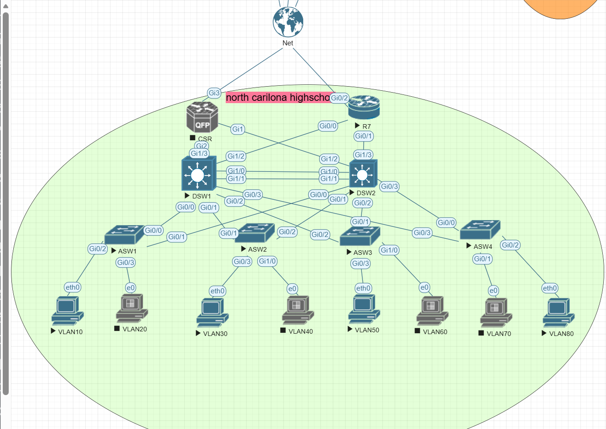

# CCNP Enterprise Campus Network Lab

**Status: Core network features verified in EVE-NG; client internet failover has a documented return-routing limitation.**

A Cisco IOSv/IOSvL2 campus lab with seven infrastructure devices (R7, DSW1, DSW2, and ASW1–ASW4), plus VPCS clients, based on supplied `show running-config` outputs. Demonstrates VLAN segmentation, multilayer distribution switching, HSRP first-hop redundancy, MST root placement, LACP EtherChannel, DHCP, static routing, and edge NAT/PAT.

## Logical topology 
### EVE-NG Network Topology


```text
                        DHCP/WAN
                           |
                          R7
                   12.12.12.1  13.13.13.1
                       /          \
             12.12.12.2          13.13.13.2
                    DSW1 ======== DSW2
                      ||  Po1 LACP ||
                 [Campus access layer]
                  ASW1 ASW2 ASW3 ASW4
                  10/20 30/40 50/60 70/80
```

**Important:** Physical access-switch-to-distribution-switch port connections were not provided, so the access-layer drawing is conceptual, not an asserted cabling map. DSW1 Gi1/3 (10.10.10.2) and DSW2 Gi1/2 (11.11.11.2) remain configured but their upstream peers are unknown.

## VLAN addressing

| VLAN | Network | DSW1 SVI | DSW2 SVI | HSRP VIP | Preferred HSRP active |
|---|---|---|---|---|---|
| 10 | 192.168.10.0/24 | 192.168.10.200 | 192.168.10.100 | 192.168.10.254 | DSW1 |
| 20 | 192.168.20.0/24 | 192.168.20.200 | 192.168.20.100 | 192.168.20.254 | DSW1 |
| 30 | 192.168.30.0/24 | 192.168.30.200 | 192.168.30.100 | 192.168.30.254 | DSW1 |
| 40 | 192.168.40.0/24 | 192.168.40.200 | 192.168.40.100 | 192.168.40.254 | DSW1 |
| 50 | 192.168.50.0/24 | 192.168.50.200 | 192.168.50.100 | 192.168.50.254 | DSW2 |
| 60 | 192.168.60.0/24 | 192.168.60.200 | 192.168.60.100 | 192.168.60.254 | DSW2 |
| 70 | 192.168.70.0/24 | 192.168.70.200 | 192.168.70.100 | 192.168.70.254 | DSW2 |
| 80 | 192.168.80.0/24 | 192.168.80.200 | 192.168.80.100 | 192.168.80.254 | DSW2 |

## Design and changes from source

- **MST:** Shared region `nilrupa`, revision 1. Instance 1 includes VLANs 10–40 (DSW1 lower priority); instance 2 includes VLANs 50–80 (DSW2 lower priority).
- **HSRP (tested running configuration):** Group 10 is reused on each VLAN; DSW1 priority 160 for VLANs 10–40 and 110 for VLANs 50–80; DSW2 priority 150 for all VLANs; preemption enabled. DSW1 is Active for VLANs 10–40 and DSW2 for VLANs 50–80. **Note:** The proposed `configs/` files use distinct groups 10–80 and different priorities, so they are not exact backups of the tested running configuration.
- **DHCP:** DSW1 only, with .100, .200, and .254 excluded from each pool. Original had overlapping DHCP pools on both distribution switches. **This removes duplicate DHCP allocation risk but leaves DHCP as a single point of failure.** For production, use a supported failover DHCP service.
- **EtherChannel:** DSW1/DSW2 Gi1/0–Gi1/1 use LACP active in Port-channel1. Confirm actual cabling.
- **Routing:** DSW1 defaults to R7 at 12.12.12.1; DSW2 defaults to R7 at 13.13.13.1. Unverified other upstream next hops were removed from default routes.
- **R7:** One NAT ACL and overload rule replaces overlapping NAT policies. Equal-cost static return routes through both distribution switches were observed; during VLAN 10 failover, removing the route via DSW1 restored client internet connectivity. A permanent automatic return-path solution has not been implemented.
- **VLANs:** Explicit VLAN definitions added to all switches. Access-port assignments follow the provided configurations.

## Configuration files

- `configs/DSW1.cfg`, `configs/DSW2.cfg` — multilayer distribution switches
- `configs/ASW1.cfg` to `configs/ASW4.cfg` — access switches
- `configs/R7.cfg` — NAT edge router

These are **cleaned, proposed configurations**, not byte-for-byte backups. Original IOS banners, command prompts, repeated terminal output, and platform defaults were removed. Some intended design corrections and explanatory interface descriptions were added.

## Verification results (tested running configuration)

The following results were observed in the EVE-NG lab. The proposed configuration files in `configs/` have **not** been verified as an exact match for these running configurations.

| Check | Observed result |
|---|---|
| DHCP on VLAN 10 VPCS | Lease `192.168.10.1/24`, gateway `192.168.10.254`, DHCP server `192.168.10.200` |
| Inter-VLAN connectivity | Client pings between tested PCs reported successful; VLAN 10 client pinged VLAN 20 gateway |
| HSRP roles | DSW1 Active for VLANs 10–40; DSW2 Active for VLANs 50–80 |
| HSRP role failover | DSW2 became Active for VLAN 10 when DSW1 VLAN 10 SVI was shut; DSW1 reclaimed Active after restoration |
| MST and LACP | MST root roles and Port-channel1 LACP verified through switch CLI |
| Distribution internet | DSW1 and DSW2 sourced successful pings to `8.8.8.8` from VLAN interfaces |
| Client internet under normal operation | VLAN 10 VPCS successfully pinged `8.8.8.8` |
| NAT/PAT | R7 translation entries showed `192.168.10.1` translated to WAN address `192.168.1.67` |
| Client internet during VLAN 10 failover | Initially failed despite HSRP gateway reachability; recovered 5/5 after removing R7's return route via DSW1 |

### HSRP failover troubleshooting case study

With DSW1's VLAN 10 SVI administratively down, DSW2 became HSRP Active and the VLAN 10 VPCS could ping the virtual gateway `192.168.10.254` (5/5). DSW2 could also ping `8.8.8.8` using source `192.168.10.100` (5/5), and R7 showed NAT translations for client `192.168.10.1`. Nevertheless, the client timed out when pinging `8.8.8.8`.

R7's routing table showed two equal-cost static return routes for `192.168.10.0/24`: via DSW1 `12.12.12.2` and via DSW2 `13.13.13.2`. As a diagnostic change, the route via DSW1 was removed:

```cisco
no ip route 192.168.10.0 255.255.255.0 12.12.12.2
```

The client then received five replies from `8.8.8.8` (5/5). This strongly implicates the equal-cost return path via DSW1 in the failure. DSW1's VLAN 10 SVI was subsequently restored and HSRP Active/Standby roles returned to the intended arrangement. **The diagnostic static-route removal is not a permanent high-availability solution**, and full automatic end-to-end failover has not yet been demonstrated.

For repeatable validation, see `verification/COMMANDS.md` and capture current CLI outputs/screenshots. Avoid describing the proposed configuration files as fully validated until they are reconciled with the tested running configurations.

## Known limitations

1. No access-switch cabling diagram or interface-status output was provided; validate trunks and VLAN propagation.
2. R7's WAN DHCP lease (`192.168.1.67`), upstream gateway (`192.168.1.1`), and Internet connectivity were verified during testing; WAN addressing is environment-dependent.
3. R7's equal-cost return routes caused a client failover issue in testing; a permanent routing/route-tracking solution remains outstanding.
4. DSW1 is a single DHCP server; DHCP service will not survive its failure without another solution.
5. Tested running configurations use HSRP group 10 on each VLAN, while proposed files use VLAN-matched group numbers; group-number reuse across separate VLANs is allowed. Reconcile proposed files before claiming they reproduce the tested state.
6. `ip http server` and `ip http secure-server` were omitted from the cleaned configurations; secure management, authentication, and management ACLs must be configured separately.
7. IOSv/IOSvL2 platform and licensing restrictions apply; no Cisco software images are distributed.

## License / usage

This repository contains configuration examples and documentation only. Use Cisco software according to its license terms. Do not deploy the example configuration to production without review.
